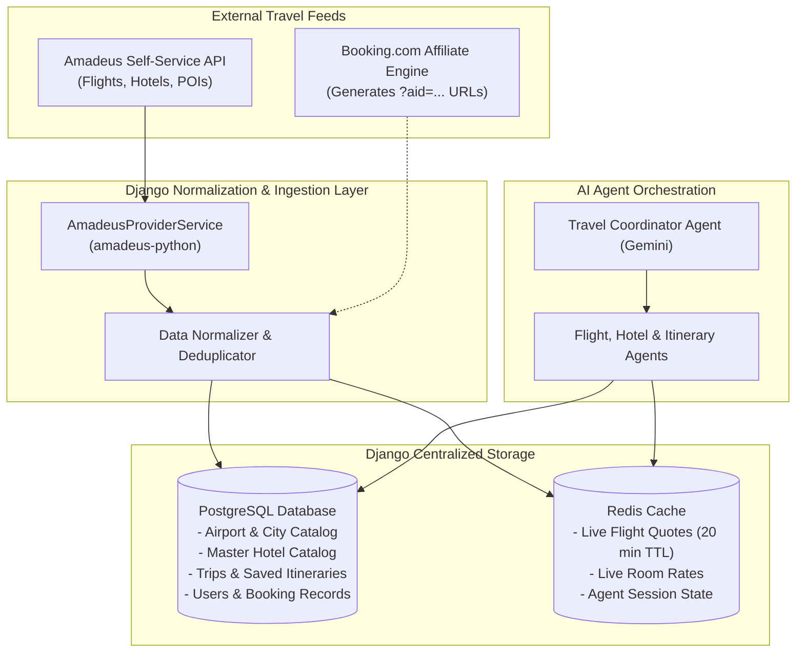

# 🧭 Wayfinder AI: Centralized Travel Architecture (Django Edition)

> **Backend Stack:** Python Django + Django REST Framework + PostgreSQL + Redis  
> **Primary Travel Provider:** Amadeus for Developers (Self-Service Tier)  
> **Affiliate Monetization:** Booking.com Affiliate Tracking Integration  
> **AI Layer:** Google Gemini + Multi-Agent Orchestration + Model Context Protocol (MCP)

---

## 📌 1. Why Django + Amadeus as the Starting Foundation?

### Why Django?
1. **Built-in Admin Dashboard**: You get an instant web GUI at `/admin` to view, search, and edit every hotel, flight offer, user trip, and booking record in your centralized database without writing a single line of frontend code.
2. **The World-Class Django ORM**: Clean Python models with automatic migrations (`makemigrations`, `migrate`), relational integrity, and foreign keys connecting Users $\rightarrow$ Trips $\rightarrow$ Flights/Hotels.
3. **Enterprise Security & Auth**: Built-in user authentication, password hashing, session management, CSRF protection, and role-based permissions out of the box.
4. **Asynchronous Tasks**: Native integration with Celery or Django Q + Redis for expiring quotes, refreshing live prices, and running background agent workflows.

---

### Why Amadeus as the #1 Primary Provider?
Instead of juggling 5 different half-working scrapers or waiting weeks for enterprise partner contracts, **Amadeus for Developers (Self-Service)** is the gold standard for your first integration:

| Feature | Amadeus Self-Service | Booking.com Official | Kayak / RapidAPI |
| :--- | :--- | :--- | :--- |
| **Covers Both Flights & Hotels** | **YES (All-in-one)** | No (Accommodations only) | Separate disjointed scrapers |
| **Instant Free Access** | **YES (Immediate API Key)** | No (Requires managed contract) | Freemium with credit card |
| **Free Request Limit** | **2,000 free calls / month** | None for self-serve | 20–100 calls / month |
| **Official Python SDK** | `amadeus-python` | None (Raw REST) | None (Community requests) |
| **Live Route & Price Data** | Real airline GDS data | Live property inventory | Scraped data (fragile) |

> **The Strategy:** We focus 100% on **Amadeus** first to get real flights, real hotels, and real airport data flowing into our **Django Centralized Database**. For monetization, we attach your **Booking.com Affiliate tracking link (`aid`)** to the hotel records. Once this pipeline is rock-solid, adding Kayak or Skyscanner later is as simple as adding another adapter!

---

## 🏛️ 2. Centralized Database Architecture in Django

Your Django database acts as the single source of truth. All external provider data is ingested, normalized, and stored in standard models before the AI agents or users ever interact with it.



---

## 🗄️ 3. Core Django Data Models (`models.py`)

Here are the concrete Django models that power the centralized database:

### A. Static Catalog Models (Stored Permanently)
```python
from django.db import models
from django.contrib.auth.models import User
import uuid

class Airport(models.Model):
    """Global airport catalog for IATA resolution."""
    iata_code = models.CharField(max_length=3, unique=True, primary_key=True) # e.g. 'JFK', 'NRT', 'BOM'
    name = models.CharField(max_length=200)
    city_name = models.CharField(max_length=100)
    country_code = models.CharField(max_length=2)
    latitude = models.DecimalField(max_digits=9, decimal_places=6)
    longitude = models.DecimalField(max_digits=9, decimal_places=6)

    def __str__(self):
        return f"{self.iata_code} - {self.name} ({self.city_name})"

class MasterHotel(models.Model):
    """Centralized Hotel Catalog de-duplicated across providers."""
    id = models.UUIDField(primary_key=True, default=uuid.uuid4, editable=False)
    name = models.CharField(max_length=255)
    city = models.CharField(max_length=100)
    neighborhood = models.CharField(max_length=100, blank=True)
    latitude = models.DecimalField(max_digits=9, decimal_places=6)
    longitude = models.DecimalField(max_digits=9, decimal_places=6)
    star_rating = models.DecimalField(max_digits=2, decimal_places=1, default=4.0)
    review_score = models.DecimalField(max_digits=3, decimal_places=1, default=8.5)
    amadeus_hotel_id = models.CharField(max_length=50, blank=True, db_index=True)
    booking_hotel_id = models.CharField(max_length=50, blank=True, db_index=True)

    def __str__(self):
        return f"{self.name} ({self.city})"
```

---

### B. Dynamic Quote & Offer Models (Stored with Expiry)
```python
class FlightOffer(models.Model):
    """Normalized flight offer received from Amadeus."""
    id = models.UUIDField(primary_key=True, default=uuid.uuid4, editable=False)
    provider = models.CharField(max_length=50, default="amadeus")
    provider_offer_id = models.CharField(max_length=255) # Raw Amadeus ID
    airline_name = models.CharField(max_length=100)
    flight_number = models.CharField(max_length=20)
    origin_airport = models.ForeignKey(Airport, on_delete=models.CASCADE, related_name="departures")
    destination_airport = models.ForeignKey(Airport, on_delete=models.CASCADE, related_name="arrivals")
    departure_time = models.DateTimeField()
    arrival_time = models.DateTimeField()
    duration_minutes = models.IntegerField()
    stops = models.IntegerField(default=0)
    cabin_class = models.CharField(max_length=30, default="economy")
    
    # Pricing
    total_amount = models.DecimalField(max_digits=10, decimal_places=2)
    currency = models.CharField(max_length=3, default="USD")
    
    # Baggage & Rules
    cabin_bags = models.IntegerField(default=1)
    checked_bags = models.IntegerField(default=1)
    is_refundable = models.BooleanField(default=False)
    
    # Freshness
    fetched_at = models.DateTimeField(auto_now_add=True)
    expires_at = models.DateTimeField() # 20 minutes from fetch
    booking_url = models.URLField(max_length=500)
```

---

### C. Trip, Itinerary & Booking State Models
```python
class Trip(models.Model):
    """The master trip plan created by user or AI."""
    id = models.UUIDField(primary_key=True, default=uuid.uuid4, editable=False)
    user = models.ForeignKey(User, on_delete=models.CASCADE, related_name="trips")
    title = models.CharField(max_length=200)
    destination_city = models.CharField(max_length=100)
    origin_city = models.CharField(max_length=100)
    start_date = models.DateField()
    end_date = models.DateField()
    passenger_count = models.IntegerField(default=1)
    budget_ceiling = models.DecimalField(max_digits=10, decimal_places=2)
    currency = models.CharField(max_length=3, default="USD")
    created_at = models.DateTimeField(auto_now_add=True)
    updated_at = models.DateTimeField(auto_now=True)

class ItineraryDay(models.Model):
    """Daily itinerary block generated by Itinerary Agent."""
    trip = models.ForeignKey(Trip, on_delete=models.CASCADE, related_name="days")
    day_number = models.IntegerField()
    date = models.DateField()
    theme = models.CharField(max_length=255) # e.g. "Historic Temples & Traditional Markets"
    activities_json = models.JSONField(default=list) # Morning, Afternoon, Evening blocks
    day_cost_estimate = models.DecimalField(max_digits=8, decimal_places=2, default=0.00)

class BookingRecord(models.Model):
    """Auditable state machine for bookings."""
    STATUS_CHOICES = [
        ("DRAFT", "Draft"),
        ("QUOTE_VALIDATED", "Quote Validated"),
        ("AWAITING_APPROVAL", "Awaiting User Approval"),
        ("SUBMITTED", "Submitted"),
        ("CONFIRMED", "Confirmed"),
        ("FAILED", "Failed"),
    ]
    id = models.UUIDField(primary_key=True, default=uuid.uuid4, editable=False)
    trip = models.ForeignKey(Trip, on_delete=models.CASCADE, related_name="bookings")
    status = models.CharField(max_length=30, choices=STATUS_CHOICES, default="DRAFT")
    idempotency_key = models.UUIDField(default=uuid.uuid4, unique=True)
    item_type = models.CharField(max_length=20) # 'flight' or 'hotel'
    provider = models.CharField(max_length=50) # 'amadeus' or 'booking.com'
    total_amount = models.DecimalField(max_digits=10, decimal_places=2)
    currency = models.CharField(max_length=3, default="USD")
    provider_reference = models.CharField(max_length=100, blank=True) # PNR
    created_at = models.DateTimeField(auto_now_add=True)
```

---

## 📁 4. Clean Django Project Directory Structure

```
wayfinder/
├── manage.py
├── pyproject.toml
├── .env
├── wayfinder_core/             # Django project config
│   ├── __init__.py
│   ├── settings.py
│   ├── urls.py
│   ├── asgi.py
│   └── wsgi.py
├── apps/
│   ├── catalog/                # Centralized Database (Airports, Hotels)
│   │   ├── models.py
│   │   ├── admin.py
│   │   └── services/           # Amadeus ingestion & normalizer
│   ├── providers/              # Provider Adapter layer
│   │   ├── base.py             # BaseProviderInterface
│   │   ├── amadeus_client.py   # Amadeus Self-Service SDK integration
│   │   ├── mock_client.py      # Offline mock fallback
│   │   └── affiliate.py        # Booking.com affiliate deep-link builder
│   ├── trips/                  # Trip planning, itineraries, budgets
│   │   ├── models.py
│   │   ├── views.py            # REST API endpoints
│   │   └── serializers.py
│   ├── agents/                 # Multi-Agent Orchestration & MCP Tools
│   │   ├── coordinator.py      # Master Orchestrator Agent (Gemini)
│   │   ├── flight_agent.py     # Flight Specialist Agent
│   │   ├── hotel_agent.py      # Accommodation Specialist Agent
│   │   ├── itinerary_agent.py  # Itinerary & Geo-cluster Agent
│   │   └── tools/              # MCP Tools querying Django ORM
│   └── bookings/               # Booking FSM, approvals & audit log
│       ├── models.py
│       └── state_machine.py
└── tests/
```

---

## 🎯 5. The Django Level-by-Level Build Plan

### **Level 0: Django Foundation & Centralized Models**
* Initialize Django project with PostgreSQL (or SQLite for quick start) and Redis.
* Create the centralized models: `Airport`, `MasterHotel`, `FlightOffer`, `Trip`, `ItineraryDay`, `BookingRecord`.
* Register all models with the **Django Admin** (`admin.py`) so you can visually inspect your database immediately.
* **Exit Criteria**: Run `python manage.py makemigrations` and `python manage.py migrate` without errors; access `/admin`.

---

### **Level 1: Amadeus Ingestion Engine & Provider Service**
* Install `amadeus` Python SDK and configure `AMADEUS_CLIENT_ID` and `AMADEUS_CLIENT_SECRET`.
* Write `AmadeusProviderService`:
  * `search_flights(origin, destination, date, passengers)` $\rightarrow$ normalizes Amadeus JSON $\rightarrow$ saves/caches `FlightOffer`.
  * `search_hotels(city_code, checkin, checkout)` $\rightarrow$ normalizes to `MasterHotel`.
* Build a `MockProviderService` for offline development.
* Build the `BookingAffiliateService` to append `?aid=YOUR_AFFILIATE_ID` to hotel URLs.
* **Exit Criteria**: Run a Django management command or REST endpoint to search flights between JFK and Tokyo and see normalized results populated in your Django database.

---

### **Level 2: Trip & Itinerary REST API (Django REST Framework / Ninja)**
* Create CRUD endpoints:
  * `POST /api/trips/`: Create a trip brief.
  * `GET /api/trips/{id}/`: Fetch full trip, saved shortlist, and itinerary days.
  * `POST /api/trips/{id}/shortlist/`: Save a flight or hotel offer to the trip.
* Add Redis cache for quote TTL (20-minute automatic expiration).
* **Exit Criteria**: A user can create and manage a complete trip plan via standard REST APIs.

---

### **Level 3: MCP Tool Layer Powered by Django ORM**
* Expose Django ORM queries and Amadeus service methods as **Model Context Protocol (MCP)** tools:
  * `tool_search_flights`: Calls `AmadeusProviderService.search_flights`.
  * `tool_search_hotels`: Calls `AmadeusProviderService.search_hotels`.
  * `tool_save_itinerary`: Writes days and time blocks into `ItineraryDay` model.
  * `tool_calculate_budget`: Sums flights, stays, activities via Python arithmetic.
* **Exit Criteria**: Tools can be invoked via standard JSON-RPC protocol with typed parameters.

---

### **Level 4: Multi-Agent AI Orchestration (Gemini)**
* Build the agent team in `apps/agents/`:
  * **Travel Coordinator Agent**: Analyzes natural language trip brief; detects missing details; delegates tasks to sub-agents.
  * **Flight Specialist Agent**: Invokes `tool_search_flights`, ranks options by duration and price.
  * **Accommodation Agent**: Invokes `tool_search_hotels`, prioritizes reviews, attaches Booking.com affiliate checkout links.
  * **Itinerary Agent**: Generates daily morning/afternoon/evening blocks clustered by geographic proximity.
  * **Budget Agent**: Validates totals against `Trip.budget_ceiling`.
* **Exit Criteria**: Asking *"Plan a 5-day trip to Tokyo in May under $2500"* triggers multi-agent coordination and creates a structured `Trip` in Django.

---

### **Level 5: Safe Booking State Machine & Approval Protocol**
* Implement the Finite State Machine in `apps/bookings/state_machine.py`:
  $$\text{DRAFT} \rightarrow \text{QUOTE\_VALIDATED} \rightarrow \text{AWAITING\_APPROVAL} \rightarrow \text{SUBMITTED} \rightarrow \text{CONFIRMED}$$
* Before transitioning to `AWAITING_APPROVAL`, Django executes a live quote refresh with Amadeus.
* Generate a unique `idempotency_key` (UUID) to guarantee no double-bookings.
* **Exit Criteria**: Full auditable booking flow operating in sandbox mode with zero hallucinations.

---

### **Level 6: Interactive Trip Workspace (Frontend UI)**
* Connect a modern React / Next.js frontend to the Django REST API.
* Split-screen workspace:
  * **Left**: Real-time chat with the Coordinator Agent.
  * **Right**: Live interactive canvas showing the Itinerary, Flight/Hotel comparison cards, and Budget chart.
  * **Buttons**: Direct "Book on Booking.com ↗" affiliate links and "Confirm Sandbox Booking" buttons.
* **Exit Criteria**: End-to-end interactive web application.

---

## 🔒 Summary Checklist

- [x] **Primary Provider**: Amadeus for Developers (Flights + Hotels in one account).
- [x] **Affiliate Monetization**: Booking.com Affiliate tracking URLs on every hotel.
- [x] **Backend Framework**: Python Django (ORM, Admin, Security, Migrations).
- [x] **Centralized Database**: Single canonical schema in PostgreSQL / SQLite.
- [x] **AI Coordination**: Gemini Multi-Agent team calling Django-powered MCP tools.
- [x] **Booking Safety**: FSM with price re-validation and human approval.

