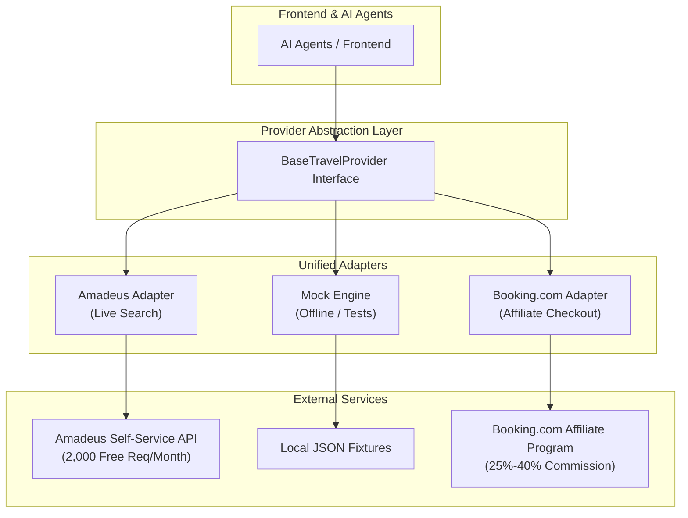
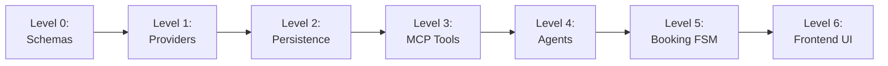
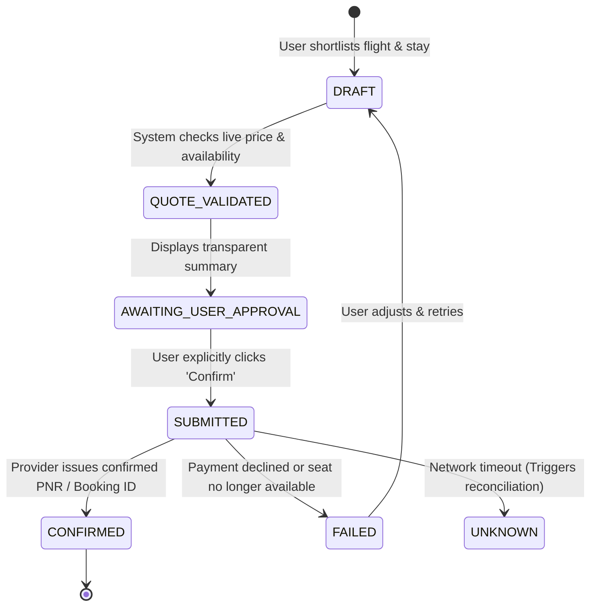

# 🧭 Wayfinder AI: Level-by-Level Implementation Blueprint

> **A Production-Minded Multi-Agent Travel Operating System**  
> *Powered by Gemini, Google ADK / Agent Framework, and the Model Context Protocol (MCP)*

---

## 📌 Executive Summary & Core Principle

Wayfinder AI is an autonomous, multi-agent travel coordination platform. Instead of forcing users to juggle dozens of browser tabs, compare disjointed airline and hotel sites, and manually calculate budgets, Wayfinder turns natural language travel goals into verified, structured, and bookable itineraries.

### 🛡️ The Golden Architectural Rule
```
┌────────────────────────────────────────────────────────────────────────────────────────┐
│  AI plans, suggests, and coordinates.                                                  │
│  Deterministic backend services and official provider APIs retain absolute control of   │
│  live pricing, availability, payments, reservations, and state transitions.           │
│  An LLM is NEVER permitted to invent prices, flight numbers, or confirm bookings.     │
└────────────────────────────────────────────────────────────────────────────────────────┘
```

---

## 🗺️ Master Phased Roadmap at a Glance

| Level | Milestone | Core Tech Stack | Objective | Exit Criteria |
| :--- | :--- | :--- | :--- | :--- |
| **Level 0** | **Domain Schemas & Repo Setup** | Python 3.13, Pydantic v2, `uv`, pytest | Establish canonical data contracts for all travel entities. | All schemas pass validation unit tests. |
| **Level 1** | **Provider Engine (Live + Mock)** | FastAPI, Amadeus SDK, Mock Engine, HTTPX | Ingest and normalize real flight & stay data with zero AI. | `/v1/flights/search` and `/v1/hotels/search` working. |
| **Level 2** | **Trip State & Persistence** | PostgreSQL/SQLite, SQLAlchemy, Redis | Store users, trips, versioned itineraries, and quote TTLs. | Full trip CRUD & version history functional. |
| **Level 3** | **MCP Tool Protocol Layer** | Model Context Protocol (MCP Python SDK) | Expose travel tools with typed JSON-RPC schemas & guardrails. | Tools callable and verifiable via MCP protocol. |
| **Level 4** | **Multi-Agent Orchestration** | Gemini API, Google ADK / Function Calling | Build Coordinator + Specialist Agents (Flight, Stay, Itinerary, Budget). | Natural language query produces full sourced trip proposal. |
| **Level 5** | **Safe Booking State Machine** | Finite State Machine (FSM), Idempotency Keys | Enforce price re-validation and explicit human approval flow. | Auditable booking simulator with zero hallucinations. |
| **Level 6** | **Interactive Web Workspace** | React / Next.js, Tailwind CSS, Shadcn UI | Deliver split-view UI: streaming chat + live interactive canvas. | Fully responsive end-to-end web application. |
| **Level 7** | **Observability & Hardening** | OpenTelemetry, Token/Cost Tracker, Docker | Add evaluation benchmarks, latency monitoring, and containerization. | Production-ready, observable, and containerized deployment. |

---

## 🔌 Travel Data & Monetization Strategy

To balance **zero initial cost**, **real-world data**, and **direct monetization**, Wayfinder AI uses a 3-pillar provider architecture:



1. **Live Search (Amadeus for Developers)**:
   * Free Self-Service tier (2,000 free searches/month, no credit card required).
   * Provides real flight routes, schedules, fares, and hotel listings.
2. **Offline & Testing (Deterministic Mock Engine)**:
   * Instant, reliable sample data simulating network delays, price drops, and seat sellouts.
   * Enables continuous development without internet or burning API quotas.
3. **Monetization (Booking.com Affiliate Integration)**:
   * Every hotel recommendation attaches a verified deep link containing your **Booking.com Affiliate ID (`aid`)**.
   * User clicks "Book on Booking.com" $\rightarrow$ Redirects to pre-filled hotel page $\rightarrow$ You earn 25%–40% commission.
4. **The Adapter Pattern**:
   * Switch between `mock`, `amadeus`, or future providers with one environment variable: `PROVIDER_MODE=mock|amadeus`.

---

## 🏗️ Detailed Level-by-Level Breakdown



---

### Level 0: Project Setup & Canonical Domain Schemas

#### 🎯 Objective
Create the repository skeleton and define typed, canonical Pydantic v2 schemas for all travel data. These schemas guarantee that external APIs, database tables, and AI agent outputs all speak the exact same language.

#### 🛠️ Tech Stack & Directory Structure
* Python 3.13, Pydantic v2, `uv` package manager, `pytest`
```
wayfinder/
├── pyproject.toml
├── .env.example
├── src/wayfinder/
│   ├── domain/
│   │   ├── common.py      # Money (ISO-4217), Coordinates, DateRange
│   │   ├── flight.py      # FlightSearchRequest, FlightOffer, BaggagePolicy
│   │   ├── hotel.py       # HotelSearchRequest, HotelOffer, RoomOption
│   │   ├── itinerary.py   # Activity, TimeBlock, ItineraryDay, TripItinerary
│   │   ├── budget.py      # CostItem, BudgetSummary, CurrencyConversion
│   │   ├── booking.py     # BookingDraft, BookingStatus, ApprovalToken
│   │   └── trip.py        # TripBrief, TripPlan, TripState
│   └── ...
└── tests/
    └── test_domain_schemas.py
```

#### 📦 Key Schemas
* **`FlightOffer`**: Airline, flight number, departure/arrival IATA, duration, stops, cabin class, baggage rules, cancellation penalties, quote expiry timestamp, and checkout URL.
* **`HotelOffer`**: Property name, neighborhood, star rating, review score, room type, nightly rate, total stay cost, amenities, and free cancellation deadline.
* **`TripBrief`**: Destination, origin, dates, passenger count, total budget ceiling, travel style (pace, interests).
* **`ItineraryDay`**: Structured time blocks (`morning`, `afternoon`, `evening`) with geographic coordinates and travel time estimates.

#### ✅ Level 0 Exit Criteria
1. Project initialized with `uv` virtual environment.
2. Canonical models defined with strict Pydantic v2 validation.
3. Automated test suite runs with 100% passing tests for serialization and constraints.

---

### Level 1: Travel Provider Engine (Flight & Hotel Adapters)

#### 🎯 Objective
Build a provider abstraction layer that queries external travel APIs, normalizes diverse JSON payloads into our canonical domain models, and exposes clean REST endpoints. **No AI is used at this stage.**

#### 🛠️ Tech Stack
* FastAPI, Uvicorn, HTTPX (async HTTP), Amadeus Python SDK

#### 🧩 Key Architecture
```
[ User / Test Client ]
          │
          ▼
   POST /v1/flights/search
          │
          ▼
┌──────────────────────────────────────────────┐
│  Flight Provider Abstraction Interface      │
├──────────────────────┬───────────────────────┤
│  MockFlightAdapter   │  AmadeusFlightAdapter │
└──────────────────────┴───────────────────────┘
          │
          ▼
Normalized List[FlightOffer] (Unified Schema)
```

#### 🚀 Key Endpoints
* `POST /v1/flights/search`: Accepts origin, destination, departure date, return date, passengers.
* `POST /v1/hotels/search`: Accepts city/coordinates, check-in, check-out, room requirements.
* `GET /v1/places/search`: Autocomplete for airport IATA codes and city destinations.

#### ✅ Level 1 Exit Criteria
1. Interactive Swagger UI (`/docs`) allows searching flights and hotels with live or mock data.
2. Flipping `PROVIDER_MODE=mock` to `PROVIDER_MODE=amadeus` works transparently without breaking API contracts.
3. Raw supplier IDs and quote timestamps are preserved on every offer.

---

### Level 2: Backend Persistence & Trip State Management

#### 🎯 Objective
Enable durable storage for trips, user preferences, shortlisted flight/hotel offers, version-controlled itineraries, and expiring quotes.

#### 🛠️ Tech Stack
* PostgreSQL / SQLite (via SQLAlchemy / SQLModel), Alembic (migrations), Redis

#### 🗄️ Database Schema
```
┌──────────────────┐       1:N       ┌──────────────────┐
│      Users       │ ─────────────── │      Trips       │
└──────────────────┘                 └────────┬─────────┘
                                              │ 1:N
             ┌────────────────────────────────┼────────────────────────────────┐
             ▼                                ▼                                ▼
┌─────────────────────────┐      ┌─────────────────────────┐      ┌─────────────────────────┐
│     ShortlistItems      │      │    ItineraryVersions    │      │      BookingRecords     │
│ (Saved Flights & Stays) │      │  (Immutable Day Plans)  │      │   (Audit & FSM State)   │
└─────────────────────────┘      └─────────────────────────┘      └─────────────────────────┘
```

#### ⚡ Redis Quote TTL
* Flight quotes change frequently. Saved quotes are cached in Redis with a 20-minute Time-To-Live (TTL).
* When a quote expires, the system flags it as stale, requiring a quick live refresh before checkout.

#### ✅ Level 2 Exit Criteria
1. Users can create, view, edit, and version trips through REST API calls.
2. Complete itinerary version history saved to database.
3. Redis handles quote expiration and session caching.

---

### Level 3: MCP (Model Context Protocol) Tool Layer

#### 🎯 Objective
Expose our backend and provider capabilities as standardized **Model Context Protocol (MCP)** tools. This decouples the agent orchestration from tool execution logic.

#### 🛠️ Tech Stack
* MCP Python SDK (`mcp`), JSON-RPC 2.0 protocol

#### 🧰 MCP Tool Catalogue
| MCP Server | Exposed Tools | Description |
| :--- | :--- | :--- |
| **`flight-tools`** | `search_flights`, `get_flight_details`, `refresh_flight_quote` | Searches airline inventory and verifies pricing. |
| **`stay-tools`** | `search_stays`, `get_hotel_details`, `refresh_stay_quote` | Searches hotels and retrieves room amenities. |
| **`places-tools`** | `search_places`, `geocode_location`, `get_route_matrix` | Resolves addresses, attractions, and transit times. |
| **`trip-tools`** | `get_trip`, `save_itinerary_version`, `shortlist_offer` | Interacts with backend trip database. |
| **`budget-tools`** | `calculate_trip_budget`, `convert_currency` | Deterministic math engine for accurate cost totals. |

#### ✅ Level 3 Exit Criteria
1. MCP servers run with typed input/output schemas.
2. Tools enforce read-only safety (modifications require explicit authorization).
3. Tools can be tested independently via the standard MCP inspector.

---

### Level 4: Multi-Agent AI Orchestration (Gemini)

#### 🎯 Objective
Build a specialized team of AI agents that collaborate to turn high-level natural language requests into complete, verified travel plans.

```
                           ┌─────────────────────────────┐
                           │   User (Natural Language)   │
                           └──────────────┬──────────────┘
                                          │
                                          ▼
                           ┌─────────────────────────────┐
                           │  Travel Coordinator Agent   │
                           │  - Parses Request           │
                           │  - Asks Clarifications      │
                           │  - Orchestrates Sub-Agents  │
                           └──────┬───────────────┬──────┘
                                  │               │
            ┌─────────────────────┴────────┐      └──────────────────────────┐
            ▼                              ▼                                 ▼
  ┌──────────────────┐           ┌──────────────────┐              ┌──────────────────┐
  │  Flight Agent    │           │  Stay Agent      │              │  Itinerary Agent │
  │  - Queries MCP   │           │  - Queries MCP   │              │  - Geo-clusters  │
  │  - Compares stops│           │  - Matches style │              │  - Pacing/hours  │
  └─────────┬────────┘           └────────┬─────────┘              └────────┬─────────┘
            │                             │                                 │
            └──────────────────────┬──────┴─────────────────────────────────┘
                                   ▼
                        ┌──────────────────────┐
                        │ Budget & Optimizer   │
                        │ - Deterministic math │
                        │ - Flags cost overrun │
                        └──────────────────────┘
```

#### 🤖 Agent Roster & Guardrails
1. **Travel Coordinator Agent (Orchestrator)**:
   * Interprets user intent; detects missing info (dates, origins, budgets) and asks focused follow-up questions.
   * *Guardrail*: Does not directly search APIs; delegates to specialist agents.
2. **Flight Search Agent**:
   * Evaluates duration vs. layovers vs. price; returns top 3 ranked recommendations.
3. **Accommodation Agent**:
   * Finds hotels matching travel pace, ratings, and budget; generates Booking.com affiliate URLs.
4. **Itinerary Builder Agent**:
   * Arranges activities by geographic clustering to minimize daily travel time; checks opening hours.
5. **Budget & Optimization Agent**:
   * Sums all expenses using the deterministic calculator tool; highlights assumptions and trade-offs.

#### ✅ Level 4 Exit Criteria
1. Natural language query (e.g. *"Plan a 7-day trip to Tokyo in May for 2 under $3000"*) produces a sourced, editable trip proposal.
2. Zero hallucinations: all prices and flight numbers map to verified provider offer IDs.

---

### Level 5: Safe Booking State Machine & Approval Protocol

#### 🎯 Objective
Implement a rock-solid, auditable booking flow with explicit human confirmation and idempotency controls.



#### 🛡️ Trust & Safety Controls
* **Explicit Human Approval**: AI can **never** trigger payments or finalize bookings autonomously.
* **Idempotency Keys**: Every booking attempt attaches a unique UUID to prevent double-charging on network retries.
* **Audit Trail**: Every state transition, timestamp, and user confirmation is logged permanently to the database.

#### ✅ Level 5 Exit Criteria
1. Complete booking state machine functioning in sandbox environment.
2. Prices and cancellation terms re-verified immediately before presenting approval modal.
3. Idempotent submission prevents duplicate reservations.

---

### Level 6: Interactive Trip Workspace (Frontend UI)

#### 🎯 Objective
Build a modern, responsive web application combining an AI conversational copilot with a live, dynamic trip workspace.

#### 🛠️ Tech Stack
* Next.js / React, Tailwind CSS, Shadcn UI, Lucide Icons

```
┌────────────────────────────────────┬─────────────────────────────────────────────────┐
│     AI Travel Copilot (Chat)       │            Dynamic Trip Canvas (Right)          │
├────────────────────────────────────┼─────────────────────────────────────────────────┤
│ User: Plan 5 days in Tokyo for     │ ┌───────────────┬──────────────┬──────────────┐ │
│ 2 people, budget $2,500.           │ │ [Itinerary]   │ [Flights/Stays]│ [Budget]   │ │
│                                    │ └───────────────┴──────────────┴──────────────┘ │
│ AI: Found 3 great flight options   │ Day 1: Arrival & Shinjuku Night Walk            │
│ and top stays in Shinjuku!         │ • 19:50 - Narita Airport Arrival                │
│ I've organized your itinerary.     │ • 21:00 - Skyliner to Shinjuku                  │
│                                    │                                                 │
│ [Ask AI to adjust plan...]         │ Selected Hotel: Hotel Gracery ($140/night)      │
│                                    │ [Book on Booking.com ↗ (Affiliate Link)]        │
└────────────────────────────────────┴─────────────────────────────────────────────────┘
```

#### ✅ Level 6 Exit Criteria
1. Modern split-screen layout with streaming AI chat responses.
2. Interactive cards for flights, hotels, and daily itinerary blocks.
3. Functional Booking.com affiliate checkout buttons and booking approval dialogs.

---

### Level 7: Observability, Evaluation & Production Hardening

#### 🎯 Objective
Ensure the system is resilient, observable, cost-effective, and fully automated for deployment.

* **Cost & Token Tracker**: Monitors input/output token usage and API costs per session.
* **OpenTelemetry Tracing**: End-to-end distributed traces for agent delegations and MCP tool executions.
* **Evaluation Benchmark**: Automated test suite scoring planning quality, tool selection accuracy, and grounding.
* **Containerization**: Multi-stage `Dockerfile` and `docker-compose.yml` for single-command deployment.

---

## 🔒 Non-Negotiable System Guardrails Checklist

Before promoting any feature, it must satisfy these 6 rules:
- [ ] **Grounded Data**: No prices or flight numbers generated from LLM memory.
- [ ] **Deterministic Math**: Budget calculations done via Python calculator tool, not LLM arithmetic.
- [ ] **Zero Autonomous Purchases**: Booking requires explicit, auditable user confirmation.
- [ ] **Provider Decoupling**: Application code depends solely on abstract provider interfaces.
- [ ] **Data Minimization**: Passport and payment data encrypted; minimal personal data stored.
- [ ] **Resilient Failure Modes**: Network timeouts lead to `UNKNOWN` state with reconciliation, never duplicate orders.

---

*This document serves as the master engineering plan for Wayfinder AI. Refer back to this document at every stage of the build.*

