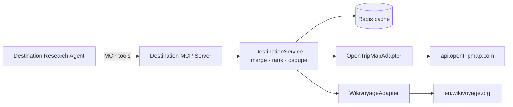

# Destination Data Plan: OpenTripMap + Wikivoyage

> **Status (Nov 2026): OpenTripMap dropped.** An account couldn't be created, so WayFinder uses Wikivoyage only for now. The OpenTripMap parts below are kept for reference. If a second source is needed, use the no-key fallback from §10 (Overpass + Wikidata), joined on the Wikidata IDs already in Wikivoyage listings.

Plan for the data layer behind the **Destination Research Agent**. It covers two public sources, one MCP server that exposes them as tools, and the adapters, caching and data model in between. Agent logic is out of scope.

## 1. What each source is for

| | OpenTripMap | Wikivoyage |
|---|---|---|
| Role | **Structured places**: what is near a location, with ratings | **Travel advice**: how to get in, get around, stay safe, where to eat |
| Data | Points of interest (POIs) with coordinates, categories (`kinds`), rating, Wikidata/Wikipedia links | Guide articles split into sections, plus listing templates (`see`, `do`, `eat`, `sleep`…) |
| Auth | Free API key (`?apikey=`) | No key. **A User-Agent with contact info is required** |
| Limits | Not published. Check the quota in your account | Wikimedia per-user limits (new in 2026). HTTP 429 when exceeded |
| Licence | Built on OpenStreetMap (ODbL) + Wikidata. Attribution required | CC BY-SA. Attribution required, and derived text must use the same licence |
| Shared key | `wikidata` ID on each place | `wikidata=` field on many listings |

The shared **Wikidata ID** is how the two sources are joined (see §5).

## 2. Where it fits



- **Adapters** handle only HTTP, auth, rate limiting and mapping to the internal model.
- **DestinationService** merges the two sources and has no knowledge of HTTP.
- **MCP server** is a thin layer over the service. Agents never call the providers directly.

## 3. API reference

### OpenTripMap
Base: `https://api.opentripmap.com/0.1/{lang}/places`

| Endpoint | Use | Key params |
|---|---|---|
| `GET /geoname?name=Kyoto` | City name → `lat`, `lon`, country, population, timezone | `name`, `country` (optional) |
| `GET /radius` | POIs around a point | `lat`, `lon`, `radius` (m), `kinds`, `rate`, `limit`, `format=json` |
| `GET /bbox` | POIs inside a bounding box | `lon_min`, `lon_max`, `lat_min`, `lat_max`, `kinds`, `rate` |
| `GET /autosuggest` | Name search near a point | `name`, `lat`, `lon`, `radius` |
| `GET /xid/{xid}` | Full detail for one POI | — returns address, image, `wikidata`, `wikipedia_extracts`, url |

Notes:
- `kinds` is hierarchical and comma-separated, e.g. `cultural,natural,foods`, `museums`, `historic`, `architecture`, `amusements`.
- `rate`: `1`–`3` (popularity), add `h` for heritage (`3h`). Use `rate=2` or higher to filter out noise.
- Use `format=json` to get a flat array. The default is GeoJSON.
- List endpoints return little detail. Call `/xid/{xid}` only for the top N results, because each call uses quota.

### Wikivoyage
Base: `https://en.wikivoyage.org/w/api.php` (Action API, always `format=json&formatversion=2`)

| Call | Use |
|---|---|
| `action=query&list=search&srsearch=Kyoto` | Find the right article title |
| `action=query&list=geosearch&gscoord=35.01\|135.76&gsradius=10000` | Guides near a coordinate (max radius 10 km) |
| `action=query&prop=extracts&exintro=1&explaintext=1&titles=Kyoto&redirects=1` | Plain-text intro summary |
| `action=parse&page=Kyoto&prop=sections` | Section list (Understand, Get in, See, Eat, Stay safe…) |
| `action=parse&page=Kyoto&prop=wikitext&section=N` | Raw wikitext for one section, to extract listings |

Listing templates in the wikitext look like:
```
* {{see | name=Kinkaku-ji | lat=35.0394 | long=135.7292 | hours=9AM-5PM
  | price=¥500 | wikidata=Q190328 | content=The Golden Pavilion... }}
```
Parse them with **`mwparserfromhell`**. The template types are `see`, `do`, `buy`, `eat`, `drink`, `sleep`, plus the generic `listing` with a `type=` field.

**Large cities are split into district articles.** For example, `Kyoto` has `Kyoto/Higashiyama` and `Kyoto/Central`. The city page holds the overview (Understand, Get in, Get around), while most listings are on the district pages. So for a large city, the adapter must:
1. find the district pages (`geosearch` returns them with `Kyoto/...` titles, or use `list=prefixsearch&pssearch=Kyoto/`)
2. collect listings from each district page
3. take the travel-advice sections from the main city page

Etiquette (required):
- Header: `User-Agent: WayFinder/0.1 (https://github.com/<you>/wayFinder; <contact-email>)`
- Send requests **one at a time**, not in parallel. Add `maxlag=5` to bulk jobs.
- Always pass `redirects=1`. Many city names are redirects or disambiguation pages.

## 4. Internal data model

```python
class Destination(BaseModel):
    name: str
    country: str | None
    lat: float
    lon: float
    timezone: str | None
    wikivoyage_title: str | None
    summary: str | None            # Wikivoyage intro
    sources: list[Attribution]

class Place(BaseModel):
    id: str                        # "otm:{xid}" or "wv:{title}#{n}"
    name: str
    category: Literal["see", "do", "eat", "drink", "sleep", "buy", "other"]
    lat: float | None
    lon: float | None
    rating: int | None             # OpenTripMap rate 1-3
    description: str | None
    address: str | None
    hours: str | None
    price: str | None
    url: str | None
    image: str | None
    wikidata: str | None
    sources: list[Attribution]     # one or both providers

class GuideSection(BaseModel):
    destination: str
    heading: str                   # "Get around", "Stay safe", ...
    text: str                      # plain text, wikitext stripped
    source: Attribution

class Attribution(BaseModel):
    provider: Literal["opentripmap", "wikivoyage"]
    url: str
    license: str                   # "ODbL", "CC BY-SA 4.0"
```

Map OpenTripMap `kinds` to `category` with a small lookup table, e.g. `museums|historic|architecture → see`, `foods → eat`, `accomodations → sleep` (the API's own spelling).

## 5. Merging the two sources

1. **Join on Wikidata ID** when both records have one. This is the most reliable match.
2. Otherwise, match on **normalised name + distance < 150 m**.
3. Merged record:
   - coordinates, rating and image from OpenTripMap
   - hours, price and description (`content`) from Wikivoyage
   - `sources` lists both, so attribution stays correct
4. Ranking for `find_places`: OpenTripMap `rate`, then whether Wikivoyage mentions it (a curated mention is a strong signal), then distance.

## 6. MCP tools

| Tool | Input | Output | Calls |
|---|---|---|---|
| `resolve_destination` | `query: str` | `Destination` | OTM `geoname` + WV `search` + `extracts` |
| `find_places` | `destination`, `categories[]`, `limit`, `min_rating` | `list[Place]` (merged) | OTM `radius` + WV listings (cached) |
| `get_place_details` | `place_id` | `Place` | OTM `xid` |
| `get_travel_guide` | `destination`, `sections[]` | `list[GuideSection]` | WV `parse` |
| `get_nearby_guides` | `lat`, `lon` | `list[{title, distance}]` | WV `geosearch` |

Rules:
- Every result includes `sources`, so the agent can cite them.
- Tools return **compact** data (cap `limit` at about 20 and truncate long text) so they don't fill the model's context.
- Errors come back as structured messages ("rate limited, retry in 30s"), not stack traces.

## 7. Caching and rate limits

| Data | Redis key | TTL |
|---|---|---|
| Geoname result | `otm:geo:{name}` | 30 days |
| Radius query | `otm:radius:{lat:.3f}:{lon:.3f}:{r}:{kinds}:{rate}` | 7 days |
| POI detail | `otm:xid:{xid}` | 30 days |
| WV section list / wikitext | `wv:parse:{title}:{section}` | 7 days |
| WV parsed listings | `wv:listings:{title}` | 7 days |

- Round coordinates to 3 decimals (about 100 m) so similar queries share a cache entry.
- **Per-provider token bucket** in Redis. Start at 5 req/s for OpenTripMap (adjust once you know your quota) and 1 concurrent request for Wikivoyage.
- On 429 / 5xx: exponential backoff with jitter, max 3 retries, and honour `Retry-After`.
- Optional warm-up job: pre-fetch the 50 most-requested cities overnight.

## 8. Project layout

```
wayfinder/
  providers/
    base.py              # HTTP client, retry, rate limiter, User-Agent
    opentripmap.py       # OpenTripMapAdapter
    wikivoyage.py        # WikivoyageAdapter + listing parser
  domain/
    models.py            # Destination, Place, GuideSection, Attribution
    categories.py        # kinds → category mapping
    destination_service.py   # merge, dedupe, rank
  mcp_servers/
    destination_server.py    # FastMCP tools from §6
  cache/
    redis_cache.py
tests/
  fixtures/              # recorded JSON / wikitext responses
  test_opentripmap.py
  test_wikivoyage_parser.py
  test_merge.py
```

Stack: Python 3.12, `httpx` (async), `pydantic`, `redis`, `mwparserfromhell`, `mcp` (FastMCP), `pytest` + `respx` for HTTP mocking.

## 9. Build phases

| Phase | Scope | Done when |
|---|---|---|
| **1. Adapters** | `base.py`, both adapters, models | Script prints `Destination` + 20 `Place`s for "Kyoto" from each source separately |
| **2. Listing parser** | Wikivoyage wikitext → `Place` | Parser tests pass on saved wikitext for 3 cities (large, small, non-English names) |
| **3. Merge service** | Wikidata join, name+distance fallback, ranking | Kyoto has fewer than 5% duplicate places after merge; merged items list both sources |
| **4. Cache + limits** | Redis TTLs, token bucket, retries | Second identical query makes 0 HTTP calls; a simulated 429 recovers |
| **5. MCP server** | Tools from §6 | Tools callable from MCP Inspector and a test agent |
| **6. Hardening** | Attribution in output, logging, metrics hooks for the observability layer | Every response includes sources; provider latency and error counts are logged |

## 10. Risks

| Risk | Mitigation |
|---|---|
| OpenTripMap is lightly maintained, limits unknown | Keep it behind the adapter. Fallback: query **Overpass** (OSM) + **Wikidata** directly, since OpenTripMap is built from them |
| Wikimedia blocks or throttles the client | Correct User-Agent, serial requests, caching. Use **database dumps** for bulk loads |
| Wikitext varies between articles | Tolerant parser, skip malformed listings, test fixtures from varied cities |
| Listings missed on large cities (they live in district pages) | Resolve `City/District` subpages and merge their listings (see §3) |
| Ambiguous names ("Paris", Texas or France) | `resolve_destination` returns candidates with country, and the agent confirms |
| Licence compliance (CC BY-SA, ODbL) | `Attribution` on every record, shown in the UI. Keep Wikivoyage text separate from generated text |

## 11. Before you start

- [ ] Register for an OpenTripMap key and record the daily quota shown in your account.
- [ ] Decide the guide language(s). Both APIs take a language (`/0.1/{lang}/`, `{lang}.wikivoyage.org`).
- [ ] Pick the contact email/URL for the Wikimedia User-Agent.
- [ ] Save fixture responses for 3 test cities before writing parser code.
